# SkillBite Logical ERD

**Project:** SkillBite  
**Model:** Logical Entity-Relationship Diagram (ERD)  
**Status:** MVP draft  
**Purpose:** Define the entities, attributes, relationships, and token lifecycle for the SkillBite platform.

## 1. Entity-Relationship Diagram

```mermaid
erDiagram
    ROLE ||--o{ USER : "has role"
    USER ||--o{ AUTH_IDENTITY : "has identities"
    USER ||--o{ AUTH_TOKEN : "has tokens"
    USER ||--o{ USER_SESSION : "has sessions"
    USER ||--o{ CONTENT : "creates"
    USER ||--o{ BOOKMARK : "saves"
    USER ||--o{ VIDEO_PROGRESS : "tracks"
    USER ||--o{ NOTIFICATION : "receives"
    USER ||--o{ NOTIFICATION_PREFERENCE : "configures"
    USER ||--o{ PUSH_DEVICE : "registers"
    USER o|--o{ AUDIT_LOG : "performs"
    USER o|--o{ SYSTEM_SETTING : "updates"

    USER_SESSION ||--o{ REFRESH_TOKEN : "has token history"

    CONTENT ||--o| VIDEO_DETAILS : "VIDEO subtype"
    CONTENT ||--o| COURSE_DETAILS : "COURSE subtype"

    CONTENT ||--o{ CONTENT_CATEGORY : "categorized as"
    CONTENT ||--o{ CONTENT_TAG : "tagged with"
    CONTENT ||--o{ CONTENT_ATTACHMENT : "has supporting file or link"
    CONTENT ||--o{ BOOKMARK : "bookmarked in"

    CATEGORY ||--o{ CONTENT_CATEGORY : "assigned to"
    TAG ||--o{ CONTENT_TAG : "assigned to"

    COURSE_DETAILS ||--o{ COURSE_MODULE : "contains"
    COURSE_MODULE ||--o{ LESSON : "contains"
    VIDEO_DETAILS ||--o{ LESSON : "used in"
    VIDEO_DETAILS ||--o{ VIDEO_CAPTION : "has captions"
    VIDEO_DETAILS ||--o{ VIDEO_PROGRESS : "has progress records"

    ROLE {
        uuid role_id PK
        string code UK
        string name
    }

    USER {
        uuid user_id PK
        uuid role_id FK
        string email_normalized UK
        string password_hash "nullable"
        string display_name
        string account_status "ACTIVE, SUSPENDED, or DEACTIVATED"
        datetime email_verified_at "nullable"
        datetime created_at
        datetime updated_at
        datetime deleted_at "nullable"
    }

    AUTH_IDENTITY {
        uuid identity_id PK
        uuid user_id FK
        string provider
        string provider_user_id
        datetime linked_at
    }

    AUTH_TOKEN {
        uuid token_id PK
        uuid user_id FK
        string token_type
        string token_hash UK
        datetime expires_at
        datetime consumed_at "nullable single-use token"
        datetime revoked_at "nullable"
        datetime created_at
    }

    USER_SESSION {
        uuid session_id PK
        uuid user_id FK
        datetime created_at
        datetime last_seen_at "nullable"
        datetime expires_at "absolute session expiry"
        datetime revoked_at "nullable"
    }

    REFRESH_TOKEN {
        uuid refresh_token_id PK
        uuid session_id FK
        string token_hash UK
        datetime issued_at
        datetime expires_at
        datetime used_at "nullable"
        datetime revoked_at "nullable"
        uuid replaced_by_token_id FK "nullable self-reference"
        datetime created_at
    }

    CONTENT {
        uuid content_id PK
        uuid creator_id FK
        string content_type "VIDEO or COURSE"
        string title
        string description "nullable"
        string status
        datetime published_at "nullable"
        datetime created_at
        datetime updated_at
        datetime deleted_at "nullable"
    }

    VIDEO_DETAILS {
        uuid content_id PK, FK
        string media_reference
        int duration_seconds
    }

    COURSE_DETAILS {
        uuid content_id PK, FK
    }

    COURSE_MODULE {
        uuid module_id PK
        uuid course_content_id FK
        string title
        int position
        datetime created_at
        datetime updated_at
    }

    LESSON {
        uuid lesson_id PK
        uuid module_id FK
        uuid video_content_id FK
        int position
        datetime created_at
        datetime updated_at
    }

    VIDEO_CAPTION {
        uuid caption_id PK
        uuid video_content_id FK
        string language_code
        string caption_reference
        string format
    }

    CATEGORY {
        uuid category_id PK
        string name UK
        string slug UK
        string description "nullable"
        boolean is_active
    }

    CONTENT_CATEGORY {
        uuid content_id PK, FK
        uuid category_id PK, FK
    }

    TAG {
        uuid tag_id PK
        string name UK
        string slug UK
    }

    CONTENT_TAG {
        uuid content_id PK, FK
        uuid tag_id PK, FK
    }

    CONTENT_ATTACHMENT {
        uuid attachment_id PK
        uuid content_id FK
        string kind "PDF, TEXT, or HYPERLINK"
        string reference "file reference or URL"
    }

    BOOKMARK {
        uuid user_id PK, FK
        uuid content_id PK, FK
        datetime created_at
    }

    VIDEO_PROGRESS {
        uuid progress_id PK
        uuid user_id FK
        uuid video_content_id FK
        int last_position_seconds
        datetime last_watched_at
        datetime completed_at "nullable"
        datetime updated_at
    }

    NOTIFICATION {
        uuid notification_id PK
        uuid user_id FK
        string notification_type
        string title
        string message
        string target_reference "nullable"
        datetime created_at
        datetime read_at "nullable"
    }

    NOTIFICATION_PREFERENCE {
        uuid user_id PK, FK
        string notification_type PK
        boolean in_app_enabled
        boolean push_enabled
        datetime updated_at
    }

    PUSH_DEVICE {
        uuid device_id PK
        uuid user_id FK
        string platform
        string encrypted_push_token
        string token_fingerprint UK "nullable"
        datetime last_registered_at
        datetime revoked_at "nullable"
    }

    AUDIT_LOG {
        uuid audit_id PK
        uuid actor_user_id FK "nullable"
        string action
        string target_type
        string target_id "polymorphic reference"
        string details
        datetime created_at
    }

    SYSTEM_SETTING {
        string setting_key PK
        string setting_value
        uuid updated_by FK "nullable"
        datetime updated_at
    }
```

## 2. Token Lifecycle

### 2.1 Authentication Tokens

The `AUTH_TOKEN` entity stores purpose-specific authentication tokens, such as email-verification and password-reset tokens.

| Attribute | Purpose |
|---|---|
| `token_id` | Unique identifier for the authentication token. |
| `user_id` | User associated with the token. |
| `token_type` | Purpose of the token. |
| `token_hash` | Hash of the token; the raw bearer token must not be stored. |
| `expires_at` | Time after which the token must be rejected. |
| `consumed_at` | Records when a single-use token was successfully consumed. |
| `revoked_at` | Records when the token was invalidated before or after its intended use. |
| `created_at` | Time the token record was created. |

**Lifecycle rules:**

1. Generate a cryptographically secure random token.
2. Store its hash rather than the raw token.
3. Associate it with a user and a defined purpose.
4. Set an expiry time.
5. Validate its purpose, expiry, and unused/unrevoked status before accepting it.
6. Consume the token atomically with the operation it authorizes.
7. Revoke prior active tokens for the same user and purpose when required by the token-issuance policy.
8. Never accept an expired, consumed, or revoked single-use token.

### 2.2 User Sessions

The `USER_SESSION` entity represents an authenticated login session. It is separate from individual refresh tokens so that a session can remain identifiable while its refresh token rotates.

| Attribute | Purpose |
|---|---|
| `session_id` | Unique identifier for the session. |
| `user_id` | User who owns the session. |
| `created_at` | Time the session was created. |
| `last_seen_at` | Most recent recorded activity, when tracked. |
| `expires_at` | Absolute session expiry time. |
| `revoked_at` | Time the session was revoked, if applicable. |

**Lifecycle rules:**

1. Create a session after successful authentication.
2. Associate it with the authenticated user.
3. Issue an initial refresh token for the session.
4. Reject refresh operations when the session has expired or been revoked.
5. On logout, revoke the session and its active refresh tokens.
6. Enforce session-expiry and revocation checks in the application.

### 2.3 Refresh Tokens

The `REFRESH_TOKEN` entity stores refresh-token records and their rotation history.

| Attribute | Purpose |
|---|---|
| `refresh_token_id` | Unique identifier for the refresh-token record. |
| `session_id` | Session to which the token belongs. |
| `token_hash` | Hash of the refresh token; never store the raw bearer token. |
| `issued_at` | Time the token was issued. |
| `expires_at` | Time the token expires. |
| `used_at` | Time the token was successfully used for refresh. |
| `revoked_at` | Time the token was revoked, if applicable. |
| `replaced_by_token_id` | Optional reference to the replacement refresh-token record. |
| `created_at` | Time the database record was created. |

**Lifecycle rules:**

1. Generate a cryptographically secure refresh token and store its hash.
2. Associate it with a valid session.
3. When refreshing, validate the token, session, expiry, and revocation state.
4. Mark the current token as used and create its replacement in the same database transaction.
5. Link the old token to its replacement through `replaced_by_token_id`.
6. Ensure concurrent refresh requests cannot successfully use the same token more than once.
7. If a previously used token is presented again, treat it as possible replay and apply the defined session or token-family revocation policy.
8. On logout or session revocation, invalidate the session's active refresh tokens.
9. Retain token history according to the application's security, privacy, and retention policies.

### 2.4 Access Tokens

Short-lived access tokens, including JWTs, are not represented by a separate entity in this ERD.

By default, validate access tokens using their signature, issuer, audience, expiry, and other required claims. If immediate server-side access-token revocation or per-token tracking is required, define that requirement and add a suitable mechanism separately.

## 3. Database Constraints

The following constraints must be implemented in database migrations or equivalent schema definitions. They are not all expressible through Mermaid ERD notation alone.

### 3.1 Uniqueness

- `ROLE`: unique `code`.
- `USER`: unique `email_normalized`.
- `AUTH_TOKEN`: unique `token_hash`.
- `USER_SESSION`: session identifier is unique as its primary key.
- `REFRESH_TOKEN`: unique `token_hash`.
- `CATEGORY`: unique `name` and unique `slug`.
- `TAG`: unique `name` and unique `slug`.
- `CONTENT_CATEGORY`: composite primary key `(content_id, category_id)`.
- `CONTENT_TAG`: composite primary key `(content_id, tag_id)`.
- `BOOKMARK`: composite primary key `(user_id, content_id)`.
- `NOTIFICATION_PREFERENCE`: composite primary key `(user_id, notification_type)`.
- `AUTH_IDENTITY`: unique `(provider, provider_user_id)`.
- `COURSE_MODULE`: unique `(course_content_id, position)`.
- `LESSON`: unique `(module_id, position)`.
- `VIDEO_CAPTION`: unique `(video_content_id, language_code, format)`.
- `VIDEO_PROGRESS`: unique `(user_id, video_content_id)`. This is video progress only. Course progress is not a row in this table.

### 3.2 Refresh-Token Constraints

- `REFRESH_TOKEN.replaced_by_token_id` must reference `REFRESH_TOKEN.refresh_token_id`.
- Enforce that a refresh token cannot replace itself.
- Prevent invalid replacement chains and circular references.
- If the rotation policy requires it, enforce at most one active refresh token per session using a database-appropriate constraint or index.
- Token consumption, replacement, and reuse detection must be transaction-safe.
- Ensure the application checks both token expiry and absolute session expiry.
- Define how token history is retained and when it can be deleted.

### 3.3 Content and Progress Constraints

- `CONTENT.content_type` must be restricted to supported values, including `VIDEO` and `COURSE`.
- Each content record must have exactly one matching subtype: `VIDEO_DETAILS` for video content or `COURSE_DETAILS` for course content, but not both.
- `VIDEO_PROGRESS.last_position_seconds` must be non-negative and no greater than the associated video's duration. It is the resume position. It does not by itself set `completed_at`.
- `USER.account_status` is `ACTIVE`, `SUSPENDED`, or `DEACTIVATED`.
- `CONTENT_ATTACHMENT.kind` is `PDF`, `TEXT`, or `HYPERLINK`. `reference` is a stored file reference or a URL. Attachments are supporting material, not a `CONTENT.content_type`.
- Course progress is calculated from the durations of the course's videos and the portion of those durations completed. It is not stored as its own progress key. Recently played content is the video progress rows. The MVP course contains videos only.

The ERD still draws `VIDEO_DETAILS` to `LESSON` as zero-to-many. ADR 0002 says one video asset belongs to one lesson. That cardinality was not changed in this correction because the video-progress key stays `(user_id, video_content_id)`. Whether the diagram should be tightened to one lesson per video is still an open approval.
- Define allowed values for `CONTENT.status`, `USER.account_status`, `AUTH_TOKEN.token_type`, and `PUSH_DEVICE.platform`.
- Define the foreign-key deletion behavior explicitly for every relationship.
- Ensure that only appropriate content types can be used as videos in lessons or progress records.

## 4. Implementation Notes

1. This document describes the logical ERD, not a complete executable database schema.
2. Mermaid's `PK`, `FK`, and `UK` markers are diagram annotations; actual database constraints must be implemented and tested.
3. Token lifecycle behavior requires application-level validation and database transaction guarantees.
4. The database engine must be selected before finalizing engine-specific indexes, check constraints, and transaction behavior.
5. Confirm the final business requirements, authentication strategy, session-expiry policy, token-retention policy, and deletion rules before production implementation.