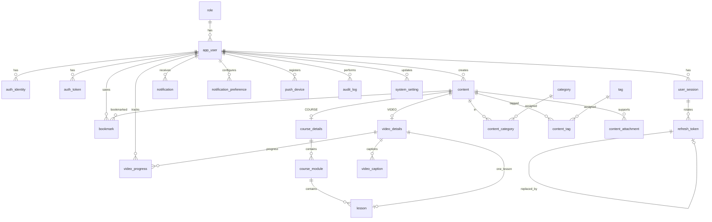

# Database

**Status:** Draft physical model. No migrations, Prisma schema, or database exists in the repository.

The logical model is [SkillBite-ERD.md](../SkillBite-ERD.md). That file owns entity names, relationships, and the token lifecycle. This file maps that model to PostgreSQL. It does not replace the ERD. Known BRD and ERD gaps are also recorded in [validation.md](validation.md). The partial Mermaid files once under `documentation/database/diagrams/` are not in the tree. `SkillBite-ERD.md` is the logical diagram. The diagram in this file is the physical relationship sketch.

**Product, architecture, and API:** [PRD.md](PRD.md), [architecture.md](architecture.md), [api.md](api.md), and ADR 0002. `architecture.md` and ADR 0001 still say the stack is unaccepted. ADR 0002 is the later implementation baseline. This file follows that baseline: one PostgreSQL database, accessed only through the API, with Prisma and versioned migrations when `backend/` is implemented. The hosting provider is not chosen (OD-16).

An earlier version of this file said no engine was selected, so physical types, indexes, and cascade clauses were withheld. ADR 0002 selects PostgreSQL. Cascades stay withheld because OD-11 and OD-12 are open. Indexes below are the intended physical indexes. They are not applied SQL.

## How to read it

- One database for Android, iOS, learner web, and the creator/admin portal. Do not split learner data by client.
- `USER.role_id` means one role per account. The physical table is `app_user` because `USER` is reserved in PostgreSQL. The entity name stays `USER`.
- `CONTENT` holds shared fields. `VIDEO_DETAILS` and `COURSE_DETAILS` hold the subtype. The ERD text requires exactly one matching subtype. Diagram lines alone do not enforce that.
- `VIDEO_PROGRESS` is the current row for a user and a video. Resume uses `last_position_seconds`. That column does not prove the completion threshold. Course progress is calculated from video durations and is not a second progress table. Recently played means those video rows. `CONTENT_ATTACHMENT` stores supporting PDFs, text files, and hyperlinks.
- Sharing is a content URL. It has no table. Payments, comments, streaks, recommendations, and share analytics have no tables.

## 1. Inconsistencies

These are recorded, not silently changed in the ERD.

| Topic | Conflict | What this file does |
|---|---|---|
| Engine | ADR 0001 and `architecture.md` say the stack is not accepted. ADR 0002 and `PRD.md` select PostgreSQL. | Use PostgreSQL. |
| Lesson video cardinality | The ERD draws `VIDEO_DETAILS` to `LESSON` as zero-to-many. `architecture.md` says reuse across lessons is drawn as allowed and is not confirmed by an explicit BRD rule. `api.md` still lists that conflict as unresolved. ADR 0002 says one video must not be referenced by two lessons. `validation.md` notes that a shared video cannot represent two lesson outcomes under `(user_id, video_content_id)`. | Unique `lesson.video_content_id`. The ERD picture and that architecture sentence are behind ADR 0002. |
| Subtype XOR | The diagram allows zero or one of each subtype. The ERD text requires exactly one of `VIDEO_DETAILS` or `COURSE_DETAILS`. `architecture.md` leaves XOR to the API unless a trigger is added. | Application transaction inserts the parent and exactly one child. No trigger is specified. |
| Publish fields missing on the ERD | ADR Q-08 and Q-12, and `api.md`, require lesson names, video sources, and keywords. Q-26 requires the caption method. The ERD has no `LESSON` title, no sources, no keywords, and no caption method. | Columns in section 3, marked **ERD gap**. |
| Content status values | Workflows and `api.md` use draft, publish, takedown, soft-delete, and restore. The ERD does not list codes. | Proposed codes in section 5. Confirm before migrating. |
| Deletion | `deleted_at` exists. OD-11 and OD-12 forbid a retention and cascade policy. `architecture.md` says not to invent cascades. | Foreign keys use `ON DELETE RESTRICT`. Soft delete is an application update. |
| Watched coverage | OD-06 is open. The ERD stores resume position and `completed_at` only. `api.md` forbids marking complete until a formula exists. | No coverage table and no generated completion. |
| Search index | Titles, descriptions, tags, and keywords must be searchable (`api.md` query `q`). `architecture.md` says a search engine is not confirmed. `api.md` also allows `sort=newest`. | Index the published browse order. No full-text index until search storage is approved. |
| Auth tables | `validation.md` once called token tables conditional on OD-16. ADR Q-18 requires verification tokens, sessions, refresh tokens, and push-device tokens. Token-history retention is still undefined (ERD section 2.3). | Keep the ERD auth entities. Do not add a purge job or a retention interval. |
| Notification preferences | The ERD has `NOTIFICATION_PREFERENCE`. `api.md` exposes preference routes. The event catalog is OD-08. | Keep the table. Do not seed event types. |
| Parental consent | Required for children under eight. `api.md` does not add a consent field. Storage is OD-10. | No consent columns. |
| Google linking | `architecture.md` says linking a Google identity to an existing email account is unspecified. `api.md` says unverified email does not link an account, and there is no approved extra step beyond a verified Google identity. | No extra column. Do not link on unverified email. |

## 2. Technology

| Choice | Value |
|---|---|
| Engine | PostgreSQL |
| Access | One API (Node.js, Express). Clients do not connect. |
| Schema tool | Prisma, versioned migrations, when `backend/` is implemented |
| Database count | One database for all clients |
| Identifiers | UUID, generated by the API (`gen_random_uuid()` is acceptable) |
| Time | `timestamptz` stored in UTC |
| Media bytes | Not in PostgreSQL. `video_details.media_reference` and attachment file references point at local storage in development and at object storage in production |

## 3. Tables and columns

Types are PostgreSQL. Nullability matches the ERD unless a constraint section says otherwise. Strings are `text`.

### 3.1 `role`

| Column | Type | Notes |
|---|---|---|
| `role_id` | `uuid` | PK |
| `code` | `text` | Unique. `USER`, `CREATOR`, `ADMIN` |
| `name` | `text` | Display label |

### 3.2 `app_user` (entity `USER`)

| Column | Type | Notes |
|---|---|---|
| `user_id` | `uuid` | PK |
| `role_id` | `uuid` | FK → `role`. Exactly one |
| `email_normalized` | `text` | Unique. Normalized by the API before insert |
| `password_hash` | `text` | Null when the account has only a Google identity |
| `display_name` | `text` | |
| `account_status` | `text` | `ACTIVE`, `SUSPENDED`, `DEACTIVATED` |
| `email_verified_at` | `timestamptz` | Null until verified |
| `created_at` | `timestamptz` | |
| `updated_at` | `timestamptz` | |
| `deleted_at` | `timestamptz` | Null while the account is not deleted. Retention is OD-11 |

No second role table. The owner changes `role_id` only between User and Creator. Admin is not a self-service value. There is no table that reconnects progress after a new registration.

### 3.3 `auth_identity`

| Column | Type | Notes |
|---|---|---|
| `identity_id` | `uuid` | PK |
| `user_id` | `uuid` | FK → `app_user` |
| `provider` | `text` | Google for the MVP provider |
| `provider_user_id` | `text` | |
| `linked_at` | `timestamptz` | |

Unique `(provider, provider_user_id)`.

### 3.4 `auth_token`

| Column | Type | Notes |
|---|---|---|
| `token_id` | `uuid` | PK |
| `user_id` | `uuid` | FK → `app_user` |
| `token_type` | `text` | `EMAIL_VERIFICATION` or `PASSWORD_RESET` |
| `token_hash` | `text` | Unique. Raw token is never stored |
| `expires_at` | `timestamptz` | |
| `consumed_at` | `timestamptz` | Null until single use |
| `revoked_at` | `timestamptz` | Null until revoked |
| `created_at` | `timestamptz` | |

Lifecycle rules stay in ERD section 2.1. Password reset does not override a non-active account. That check is in the API. The reset response must not reveal whether the email exists.

### 3.5 `user_session`

| Column | Type | Notes |
|---|---|---|
| `session_id` | `uuid` | PK |
| `user_id` | `uuid` | FK → `app_user` |
| `created_at` | `timestamptz` | |
| `last_seen_at` | `timestamptz` | Null if unused |
| `expires_at` | `timestamptz` | Absolute session expiry |
| `revoked_at` | `timestamptz` | Set on logout or reuse detection |

Access tokens (JWTs) are not a table. ERD section 2.4.

### 3.6 `refresh_token`

| Column | Type | Notes |
|---|---|---|
| `refresh_token_id` | `uuid` | PK |
| `session_id` | `uuid` | FK → `user_session` |
| `token_hash` | `text` | Unique |
| `issued_at` | `timestamptz` | |
| `expires_at` | `timestamptz` | |
| `used_at` | `timestamptz` | Null until rotated |
| `revoked_at` | `timestamptz` | |
| `replaced_by_token_id` | `uuid` | Null, or FK → `refresh_token`. Must not equal `refresh_token_id` |
| `created_at` | `timestamptz` | |

Rotation, reuse detection, and family revocation are API transactions described in the ERD. At most one row per session may have both `used_at` and `revoked_at` null (partial unique index).

### 3.7 `content`

| Column | Type | Notes |
|---|---|---|
| `content_id` | `uuid` | PK |
| `creator_id` | `uuid` | FK → `app_user` |
| `content_type` | `text` | `VIDEO` or `COURSE` |
| `title` | `text` | |
| `description` | `text` | Null allowed on the ERD. Required before video publish by the API |
| `keywords` | `text` | **ERD gap.** Searchable keywords from Q-08, Q-12, and `api.md` |
| `status` | `text` | See section 5 |
| `published_at` | `timestamptz` | Null until first publish |
| `created_at` | `timestamptz` | |
| `updated_at` | `timestamptz` | |
| `deleted_at` | `timestamptz` | Admin soft-delete. Restorable. Not a hard delete |

### 3.8 `video_details`

| Column | Type | Notes |
|---|---|---|
| `content_id` | `uuid` | PK and FK → `content` |
| `media_reference` | `text` | Storage key, not the file bytes |
| `duration_seconds` | `integer` | `>= 0` |
| `sources` | `text` | **ERD gap.** Required before video publish (Q-08, `api.md`) |

### 3.9 `course_details`

| Column | Type | Notes |
|---|---|---|
| `content_id` | `uuid` | PK and FK → `content` |

A course is publishable only when every module has a name and every lesson has a name and one video. That is an API check.

### 3.10 `course_module`

| Column | Type | Notes |
|---|---|---|
| `module_id` | `uuid` | PK |
| `course_content_id` | `uuid` | FK → `course_details.content_id` |
| `title` | `text` | Module name |
| `position` | `integer` | Unique within the course. `>= 1` |
| `created_at` | `timestamptz` | |
| `updated_at` | `timestamptz` | |

### 3.11 `lesson`

| Column | Type | Notes |
|---|---|---|
| `lesson_id` | `uuid` | PK |
| `module_id` | `uuid` | FK → `course_module` |
| `video_content_id` | `uuid` | FK → `video_details`. Unique across lessons |
| `title` | `text` | **ERD gap.** Lesson name required by Q-08 and `api.md` |
| `position` | `integer` | Unique within the module. `>= 1` |
| `created_at` | `timestamptz` | |
| `updated_at` | `timestamptz` | |

Watch order is not stored. Display order is `position`.

### 3.12 `video_caption`

| Column | Type | Notes |
|---|---|---|
| `caption_id` | `uuid` | PK |
| `video_content_id` | `uuid` | FK → `video_details` |
| `language_code` | `text` | English UI; caption language still stored |
| `caption_reference` | `text` | File or track reference |
| `format` | `text` | Not enumerated |
| `method` | `text` | **ERD gap.** `UPLOADED` or `GENERATED` (Q-26) |
| `reviewed_at` | `timestamptz` | **ERD gap.** Null until reviewed. Captions are not a publish blocker while Q-26 stands |

Unique `(video_content_id, language_code, format)`.

### 3.13 `category`, `content_category`, `tag`, `content_tag`

`category`: `category_id uuid` PK, `name text` unique, `slug text` unique, `description text` null, `is_active boolean`.

`content_category`: PK `(content_id, category_id)`, both FKs.

`tag`: `tag_id uuid` PK, `name text` unique, `slug text` unique.

`content_tag`: PK `(content_id, tag_id)`, both FKs.

Trending is a category row, not a score and not a ranking table.

### 3.14 `content_attachment`

| Column | Type | Notes |
|---|---|---|
| `attachment_id` | `uuid` | PK |
| `content_id` | `uuid` | FK → `content` |
| `kind` | `text` | `PDF`, `TEXT`, `HYPERLINK` |
| `reference` | `text` | File key or URL |

Optional. Not a content type. No reading-progress columns. The API may delete an owned attachment row. That is not content removal.

### 3.15 `bookmark`

PK `(user_id, content_id)`. `created_at timestamptz`. Both columns are FKs. A second insert of the same pair fails. The API returns 409 for that conflict.

### 3.16 `video_progress`

| Column | Type | Notes |
|---|---|---|
| `progress_id` | `uuid` | PK |
| `user_id` | `uuid` | FK → `app_user` |
| `video_content_id` | `uuid` | FK → `video_details` |
| `last_position_seconds` | `integer` | Resume only. `>= 0` and `<= duration_seconds` |
| `last_watched_at` | `timestamptz` | History and continue-learning. List newest first |
| `completed_at` | `timestamptz` | Null until a completion rule exists and is met. Never set from last position alone |
| `updated_at` | `timestamptz` | |

Unique `(user_id, video_content_id)`. One current row. No session-history table. Existing `completed_at` values stay when the threshold setting changes. Course progress is computed in the API from this table and video durations. It is not stored.

### 3.17 `notification`, `notification_preference`, `push_device`

`notification`: `notification_id uuid` PK, `user_id uuid` FK, `notification_type text`, `title text`, `message text`, `target_reference text` null (not a foreign key), `created_at timestamptz`, `read_at timestamptz` null.

`notification_preference`: PK `(user_id, notification_type)`, `in_app_enabled boolean`, `push_enabled boolean`, `updated_at timestamptz`. No rows until OD-08 lists types. Essential account and security messages are not optional preferences. Do not add publication-approval types.

`push_device`: `device_id uuid` PK, `user_id uuid` FK, `platform text`, `encrypted_push_token text`, `token_fingerprint text` unique null, `last_registered_at timestamptz`, `revoked_at timestamptz` null. The push provider is not chosen. Firebase is an example, not a schema dependency.

### 3.18 `audit_log`

| Column | Type | Notes |
|---|---|---|
| `audit_id` | `uuid` | PK |
| `actor_user_id` | `uuid` | FK → `app_user`, null if the actor row cannot be kept |
| `action` | `text` | Catalog is OD-13 |
| `target_type` | `text` | Polymorphic. Not a foreign key |
| `target_id` | `text` | Polymorphic. Not a foreign key |
| `details` | `text` | No secrets, raw tokens, or password hashes |
| `created_at` | `timestamptz` | |

The API inserts in the same transaction as the admin change. There is no application update or delete of audit rows.

### 3.19 `system_setting`

| Column | Type | Notes |
|---|---|---|
| `setting_key` | `text` | PK |
| `setting_value` | `text` | |
| `updated_by` | `uuid` | FK → `app_user`, null |
| `updated_at` | `timestamptz` | |

The completion threshold is one row. The API reads and updates it. Initial value `90`. Proposed key `completion_threshold_percent`. **The key string is a proposal** until an approved name exists. The API checks the allowed range. The database stores the value. It does not rewrite `video_progress`.

## 4. Relationships

`video_details` to `lesson` is drawn here as one lesson, matching ADR 0002. The ERD picture still shows zero-to-many.

Every foreign key is `ON DELETE RESTRICT` and `ON UPDATE RESTRICT`. Cascade and `SET NULL` are not approved. `actor_user_id` and `updated_by` stay restrict as well. A user row is not hard-deleted while OD-11 is open.

Subtype XOR, refresh replay handling, and “a video referenced by a lesson must have `content_type = VIDEO`” are application rules. They are not single-column foreign keys.

## 5. Constraints and validation

| Rule | Where |
|---|---|
| `account_status` in `ACTIVE`, `SUSPENDED`, `DEACTIVATED` | Check |
| `content_type` in `VIDEO`, `COURSE` | Check |
| `content.status` in `DRAFT`, `PUBLISHED`, `UNPUBLISHED`, `REMOVED` | Check. **Proposed.** Takedown is `UNPUBLISHED`. Admin delete sets `deleted_at`. Restore clears removal. Restore is not its own status |
| `token_type` in `EMAIL_VERIFICATION`, `PASSWORD_RESET` | Check |
| `attachment.kind` in `PDF`, `TEXT`, `HYPERLINK` | Check |
| `caption.method` in `UPLOADED`, `GENERATED` when the column is non-null | Check |
| `push_device.platform` in `IOS`, `ANDROID`, `WEB` | Check. **Proposed** from the clients |
| `duration_seconds >= 0`, positions `>= 1`, `last_position_seconds >= 0` | Check |
| Last position `<=` that video’s duration | API, or a constraint trigger later. Not a plain check across tables |
| Email unique after normalization | Unique. Duplicate register is HTTP 409 |
| One progress row per user and video | Unique |
| One bookmark per user and content | Primary key. Duplicate is HTTP 409 |
| Module position unique per course; lesson position unique per module | Unique |
| One lesson per video | Unique on `lesson.video_content_id` |
| Role code unique; category and tag name and slug unique | Unique |
| Caption `(video_content_id, language_code, format)` unique | Unique |
| Identity `(provider, provider_user_id)` unique | Unique |
| Refresh token does not replace itself | Check |
| Replacement chains must not cycle | API transaction. A single check cannot see the whole chain. No extra table |
| One unconsumed, unrevoked refresh token per session | Partial unique index |
| Refresh-token history retention | Undefined. Do not delete history on a guessed schedule |
| Password required unless an `auth_identity` exists | API |
| Only `ACTIVE` uses protected operations. `SUSPENDED` and `DEACTIVATED` are HTTP 403 | API |
| Publish requires the Q-08 fields. A published video edit is HTTP 409 | API |
| `completed_at` not derived from last position | API. No formula until OD-06 |
| Learners read `PUBLISHED` rows with `deleted_at` null. Drafts are visible to the owner and Admin | API |

## 6. Indexes

Primary keys and unique constraints already index those columns. Extra indexes match reads in `api.md`:

| Index | Query |
|---|---|
| `app_user (role_id)` | Role checks and admin user lists |
| `app_user (account_status)` | Admin status filters |
| `auth_token (user_id, token_type)` where `consumed_at` is null and `revoked_at` is null | Find the live verification or reset token |
| `user_session (user_id)` where `revoked_at` is null | Logout and session revocation |
| `refresh_token (session_id)` | Rotate and revoke a session’s tokens |
| `content (creator_id, status)` | Creator’s own list |
| `content (status, published_at desc)` where `status = 'PUBLISHED'` and `deleted_at` is null | Learner browse and `sort=newest` |
| `content_category (category_id)` | Category filter, including Trending |
| `content_tag (tag_id)` | Tag filter and tag search |
| `course_module (course_content_id, position)` | Course outline. The unique pair covers this |
| `lesson (module_id, position)` | Outline. The unique pair covers this |
| `video_progress (user_id, last_watched_at desc)` | History and continue learning |
| `bookmark (user_id, created_at desc)` | Bookmark list. Leading `user_id` in the PK does not order by time |
| `notification (user_id, created_at desc)` | In-app list |
| `push_device (user_id)` where `revoked_at` is null | Send push |
| `audit_log (created_at desc)` | Admin audit list |
| `audit_log (actor_user_id, created_at desc)` | Audit by actor, when the API filters that way |

Search across title, description, tags, and keywords has **no index yet**. Adding a PostgreSQL `tsvector` or an external engine needs an approved search design (`architecture.md`: search engine undecided).

## 7. Ownership and authorization

The database does not infer the caller. The API uses the session’s `user_id`, then reads `role_id` and `account_status` from `app_user`. A role sent by the client is ignored except on `PATCH /api/v1/me/role`, which may set only `USER` or `CREATOR`.

| Data | Owner or rule |
|---|---|
| Progress, bookmarks, notifications, preferences, push devices, sessions, tokens | The `user_id` on the row. Another user cannot read them |
| Content | `creator_id`. That creator edits drafts and takes down their published video. They do not delete or restore |
| Categories, tags, settings, any user’s status, any content’s admin delete or restore | Admin role only |
| Audit log | Insert by admin actions. No user-facing update |
| Course progress | Not a row. Computed for the signed-in user from that course’s videos and that user’s `video_progress` |
| Admin analytics | Derived from progress rows. No aggregate table until OD-09 |

`SUSPENDED` and `DEACTIVATED` fail before these checks. Hiding a screen is not authorization.

## 8. Row-level security

PostgreSQL row-level security is **not** used. Authorization is in the API. End users are not database roles. Turning RLS on without policies would block Prisma and is not an approved control.

The application role is the only login that can use the schema. Admin tools and backups use a separate operational role that is not embedded in the app. If a future client is allowed to connect as the end user, RLS must be designed before that connection exists. That client is out of scope.

## 9. Sensitive data

| Data | Handling |
|---|---|
| `password_hash` | Argon2id or another current password hash. Never reversible. Never logged |
| `auth_token.token_hash`, `refresh_token.token_hash` | Hash only. Compare in constant time in the API |
| Access token | Signature and claims. Not stored |
| `encrypted_push_token` | Encrypted at rest as the column requires. Algorithm and key location are not specified. Do not store the provider token in plaintext |
| `token_fingerprint` | Lookup key, not the raw push token |
| `email_normalized` | Personal data. Do not put it in URLs, analytics, or audit `details` unless the audit event truly needs it. Password-reset responses do not reveal whether it exists |
| Errors and logs | No raw tokens, password hashes, stack traces, or other users’ progress |

Secrets and the database URL stay in environment variables, not in source. Google checks the identity token. A client-typed email is not proof.

## 10. Migration and seed strategy

Do not add migration files until `backend/` exists. When it does:

1. Add a Prisma schema that matches this file and the ERD, including the gaps in section 1.
2. Keep migrations in the Prisma migration directory. One forward migration per change. Do not edit a migration that has already been applied to a shared database.
3. Roll back a bad migration with a new forward migration, or by restoring a backup. Do not drop production tables to reset.
4. Seed reference data only:
   - `role` rows `USER`, `CREATOR`, `ADMIN`
   - category Trending, `is_active = true`, stable slug `trending`
   - `system_setting` threshold row if the key name is approved
5. Do not seed users, passwords, progress, or sample content in a migration that runs in production. Development fixtures, if any, stay out of the production migration path and out of git if they contain secrets.
6. Do not seed notification types until OD-08 is closed.

## 11. Backup and recovery

The provider is not chosen. Before any shared or production data:

- Take automated backups of the database and of the object store that holds media. Metadata without files is not a full restore, and files without metadata are not a full restore.
- Store backups outside the application server and outside git.
- Restrict backup access the same way as the database URL.
- Run a restore onto a separate database at least once and confirm a published video row still points at its media reference.
- Do not invent a retention period. OD-11 still has no retention rule. Backup retention is an operational choice and is not the account-deletion policy.

Soft-deleted content (`deleted_at` set) remains in backups and remains restorable by the admin. Hard delete and account-deletion cascades wait for OD-11 and OD-12.

## 12. Still not in the schema

Coverage segments or a completion formula (OD-06). Parental-consent storage (OD-10). Account-deletion and creator-deactivation effects (OD-11, OD-12). A closed notification catalog (OD-08). Analytics aggregate tables (OD-09). An audit action catalog (OD-13). A full-text or external search index. A chosen backup product. A retention interval for refresh-token history. SQL migrations, because `backend/` does not exist yet.
